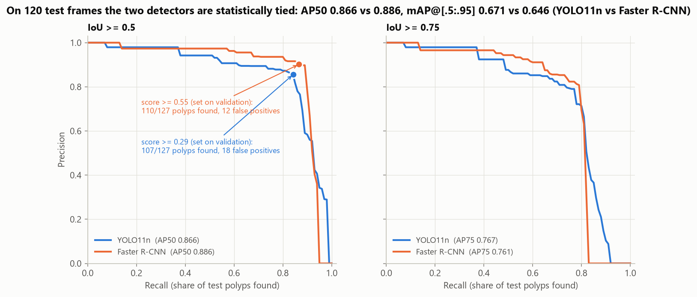
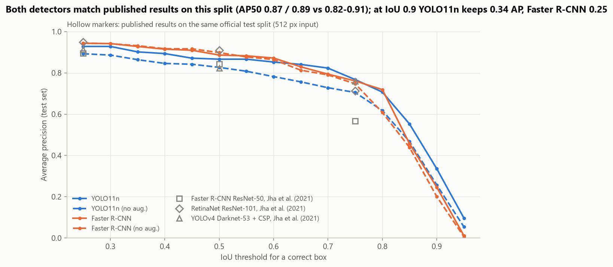
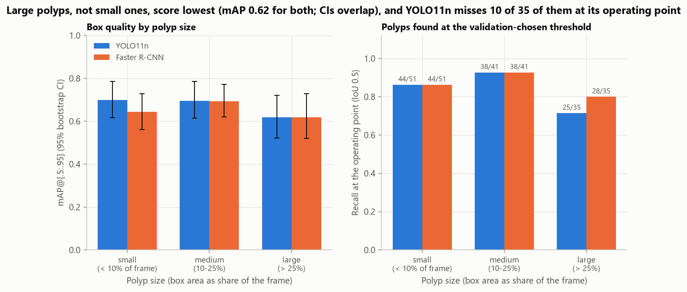
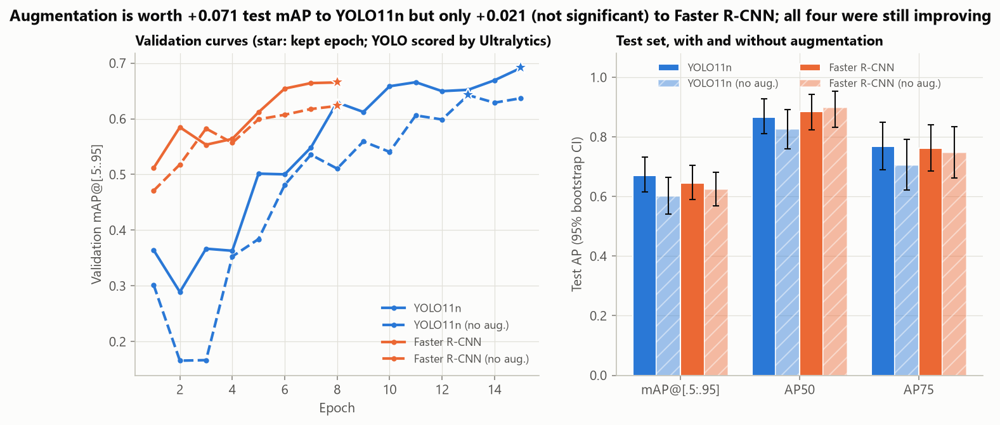
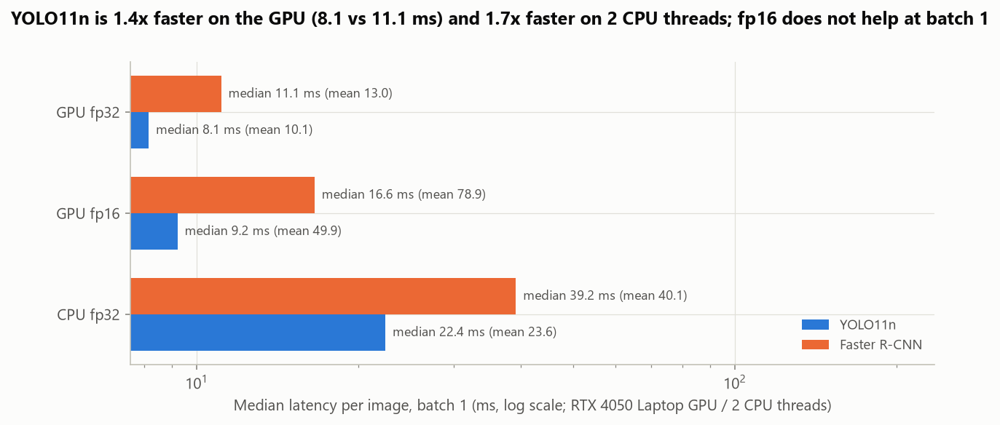
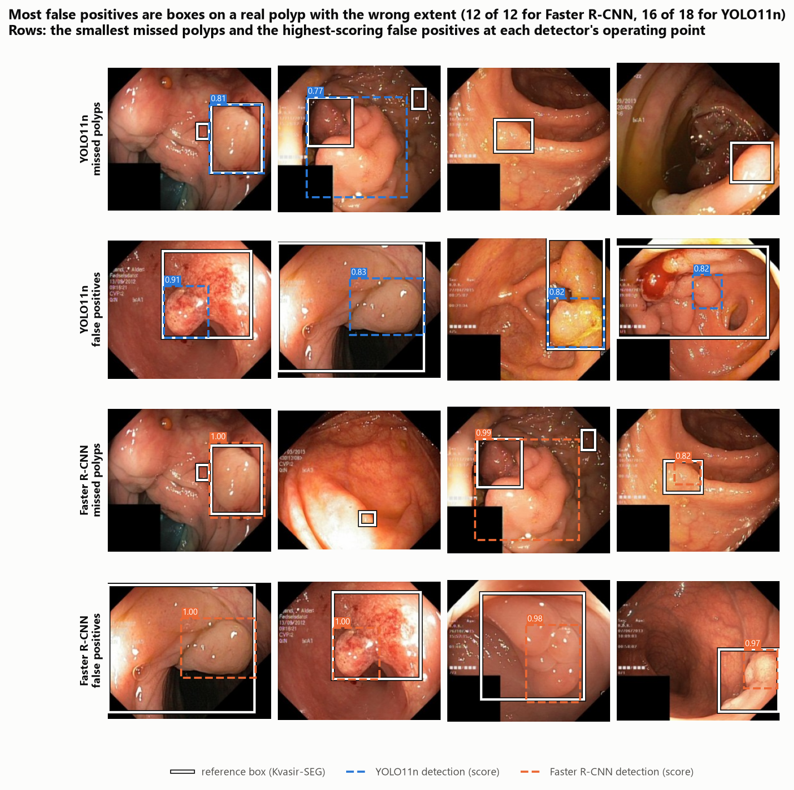
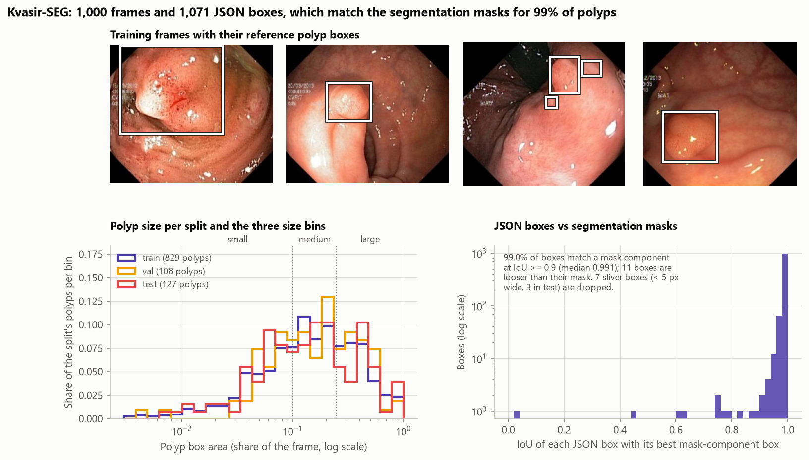

# Colonoscopy Polyp Detection: YOLO vs Faster R-CNN

**Should a colonoscopy polyp detector start from a one-stage YOLO or a two-stage Faster R-CNN?** This project
fine-tunes both from COCO weights on Kvasir-SEG (1,000 colonoscopy frames with polyp boxes and masks) under the same
conditions: the same 780 training frames, the same input size (longer side 416 px), a similar training budget of
about 1.5-2 minutes on a laptop RTX 4050, and one pycocotools evaluation for both. The detectors are Ultralytics
**YOLO11n** (2.6 M parameters) and torchvision's **Faster R-CNN with a MobileNetV3-Large FPN backbone** (19.0 M).

It mirrors the evaluation behind a computer-aided detection (CADe) prototype for endoscopy, where a model draws a box
around every polyp in the video so that fewer are overlooked (the dataset authors cite miss rates of 14-30%). The
two detectors are compared on COCO average precision with bootstrap confidence intervals, against published results
on the same official split, at a fixed operating point (how many polyps are found, how many false alarms), by polyp
size, with and without augmentation, on speed, and through their false positives and misses.



## Key findings

| Test set: 120 frames, 127 polyps | YOLO11n | Faster R-CNN (MobileNetV3-FPN) |
|---|---:|---:|
| AP50 (95% bootstrap CI) | 0.866 (0.811-0.927) | 0.886 (0.824-0.943) |
| AP75 | 0.767 | 0.761 |
| mAP@[.5:.95] (95% bootstrap CI) | 0.671 (0.616-0.733) | 0.646 (0.590-0.705) |
| AP@[.25:.75], the summary AP of Jha et al. (2021) | 0.867 | 0.878 |
| Polyps found at the validation-chosen threshold (IoU 0.5) | 107 / 127 (84.3%) | 110 / 127 (86.6%) |
| False positives per frame at that threshold | 0.15 | 0.10 |
| mAP@[.5:.95] without any augmentation | 0.600 | 0.624 |
| Median latency, batch 1, GPU fp32 / 2 CPU threads | 8.1 ms / 22.4 ms | 11.1 ms / 39.2 ms |
| Training (GPU seconds, epochs) | 107 s, 15 | 97 s, 8 |

<sub>All rows from [`coco_metrics.csv`](reports/results/coco_metrics.csv),
[`metric_cis.csv`](reports/results/metric_cis.csv), [`operating_point.csv`](reports/results/operating_point.csv),
[`speed.csv`](reports/results/speed.csv) and [`models.csv`](reports/results/models.csv). AP is the 101-point
interpolated COCO average precision; mAP@[.5:.95] averages it over IoU thresholds 0.5 to 0.95.</sub>

1. **The two detectors are statistically tied on accuracy.** Faster R-CNN is ahead by 0.020 AP50 (paired bootstrap
   CI -0.014 to +0.054) and YOLO11n by 0.025 mAP@[.5:.95] (CI -0.011 to +0.060). No difference between them survives
   the Holm correction over 11 comparisons; the largest, YOLO11n's +0.055 AP on small polyps, has an unadjusted
   p = 0.035 and an adjusted p = 0.35. Their misses overlap heavily: 14 polyps are missed by both, 6 only by YOLO11n
   and 3 only by Faster R-CNN.
2. **Both match the results published for larger detectors on the same split.** Jha et al. (2021) report AP50
   0.82-0.91 and AP75 0.57-0.76 for Faster R-CNN ResNet-50, RetinaNet ResNet-101, YOLOv3 and YOLOv4 at 512 x 512;
   the models here reach AP50 0.866 / 0.886 and AP75 0.767 / 0.761 (just above the best published) at 416 px.
   Above IoU 0.8 YOLO11n keeps more AP (0.34 vs 0.25 at IoU 0.9), so its boxes are tighter at the extreme, but this
   is inside the non-significant mAP difference.
3. **YOLO11n needs augmentation, Faster R-CNN much less.** Turning every augmentation off costs YOLO11n 0.071
   mAP@[.5:.95] (CI +0.029 to +0.115, Holm p = 0.016, the only significant comparison) and 11 found polyps at its
   operating point; Faster R-CNN loses 0.021 mAP (not significant) and its AP50 does not drop (0.886, against 0.898
   without augmentation).
4. **YOLO11n is 1.4x faster on the GPU and 1.7x faster on two CPU threads** with 7x fewer parameters (median
   batch-1 latency 8.1 vs 11.1 ms and 22.4 vs 39.2 ms). Half precision does not speed up either model at batch 1.
5. **Large polyps, not small ones, score lowest, and most errors are about a polyp's extent.** Polyps covering more
   than a quarter of the frame reach mAP 0.62 with both detectors (0.64-0.70 for smaller ones; the intervals
   overlap), and YOLO11n misses 10 of 35 of them. All 12 of Faster R-CNN's false positives and 16 of YOLO11n's 18
   lie on a real polyp: a box on one lobe of a large polyp, a second box on a found polyp, or one box around polyps
   the reference splits.
6. **The reference boxes hold up.** The archive and the official split match their pinned SHA-256 digests (12 of 12
   data checks), and 99.0% of the 1,064 JSON boxes match the bounding box of their segmentation mask at IoU >= 0.9.
   Seven sliver boxes, 1-3 pixels wide, are annotation artefacts and were dropped by a rule fixed before training.

## Results

### Accuracy and localisation



Paired bootstrap over test frames (1,000 resamples; Holm correction over all 11 comparisons;
[`significance.csv`](reports/results/significance.csv)):

| Comparison | Metric | Difference | 95% CI | p (Holm) |
|---|---|---:|---:|---:|
| YOLO11n vs Faster R-CNN | AP50 | -0.020 | -0.054 to +0.014 | 1.00 |
| | AP75 | +0.006 | -0.065 to +0.071 | 1.00 |
| | mAP@[.5:.95] | +0.025 | -0.011 to +0.060 | 1.00 |
| | AP@[.25:.75] | -0.011 | -0.041 to +0.016 | 1.00 |
| | mAP, small / medium / large polyps | +0.055 / +0.002 / +0.001 | | 0.35 / 1.00 / 1.00 |
| YOLO11n with vs without augmentation | mAP@[.5:.95] | **+0.071** | +0.029 to +0.115 | **0.016** |
| | AP50 | +0.040 | +0.002 to +0.084 | 0.54 |
| Faster R-CNN with vs without augmentation | mAP@[.5:.95] | +0.021 | -0.012 to +0.053 | 1.00 |
| | AP50 | -0.012 | -0.052 to +0.022 | 1.00 |

The AP-against-IoU curves of the two augmented detectors stay close to each other up to IoU 0.8. Faster R-CNN is
marginally ahead at loose thresholds (AP25 0.943 vs 0.928), YOLO11n at strict ones (AP85 0.552 vs 0.457, AP90
0.336 vs 0.246, AP95 0.096 vs 0.011), and the boxes YOLO11n gets right overlap the reference by a mean IoU of 0.880
against 0.862 at the operating point. Single IoU thresholds were not tested separately.

**Published reference** ([`published_comparison.csv`](reports/results/published_comparison.csv)). Jha et al. (2021)
benchmarked detectors on the same official 880 / 120 split:

| Model | Backbone, input | AP@[.25:.75] | AP25 | AP50 | AP75 |
|---|---|---:|---:|---:|---:|
| Faster R-CNN, Jha et al. (2021) | ResNet-50, 512 x 512 | 0.787 | 0.895 | 0.842 | 0.566 |
| RetinaNet, Jha et al. (2021) | ResNet-101, 512 x 512 | 0.875 | 0.948 | 0.910 | 0.713 |
| YOLOv3 + SPP, Jha et al. (2021) | Darknet-53, 512 x 512 | 0.811 | 0.886 | 0.853 | 0.759 |
| YOLOv4, Jha et al. (2021) | Darknet-53 + CSP, 512 x 512 | 0.851 | 0.912 | 0.823 | 0.759 |
| **YOLO11n, this project** | 416 px longer side | 0.867 | 0.928 | 0.866 | 0.767 |
| **Faster R-CNN, this project** | MobileNetV3-Large FPN, 416 px | 0.878 | 0.943 | 0.886 | 0.761 |

Both small modern detectors land in the upper part of the published range. The paper's AP uses a different
interpolation than pycocotools, and it calls the 120 images a validation set, so they may also have guided its model
selection; the comparison checks that this pipeline is plausible rather than ranking the models.

### At a CADe operating point

A deployed detector reports boxes above a score threshold. For each model the threshold that maximises F1 at
IoU 0.5 on the 100 validation frames is applied unchanged to the test frames
([`operating_point.csv`](reports/results/operating_point.csv)):

| Test set, IoU 0.5 | YOLO11n | Faster R-CNN | YOLO11n, no aug. | Faster R-CNN, no aug. |
|---|---:|---:|---:|---:|
| Score threshold (from validation) | 0.29 | 0.55 | 0.21 | 0.96 |
| Polyps found | 107 / 127 | 110 / 127 | 96 / 127 | 101 / 127 |
| False positives | 18 | 12 | 27 | 6 |
| Precision | 0.856 | 0.902 | 0.780 | 0.944 |
| Frames with at least one correct box | 85.8% | 88.3% | 79.2% | 82.5% |

The validation and test operating points agree closely (YOLO11n recall 0.81 vs 0.84, Faster R-CNN 0.87 vs 0.87),
so the thresholds transfer. The Faster R-CNN trained without augmentation is very confident (threshold 0.96): it
raises few false alarms and misses more polyps.

### Polyp size



Size is the box area as a share of the frame, because the frames range from 332 x 487 to 1920 x 1072 pixels:
small < 10% (51 test polyps; median 5.4% of the frame over all splits), medium 10-25% (41), large > 25% (35).
Large polyps score lowest with both detectors, mAP 0.62, against 0.64-0.70 for smaller ones, though the intervals
overlap ([`size_breakdown.csv`](reports/results/size_breakdown.csv)). At the operating point YOLO11n finds 25 of 35 large
polyps and Faster R-CNN 28, against 44 of 51 small polyps for each. A plausible reason, consistent with the error
gallery below, is that a large polyp's extent is less clear-cut: several lobes, part of it out of view, or a group of
polyps that one reference box covers.

### Augmentation ablation



YOLO11n is trained with Ultralytics' default augmentation (mosaic, HSV jitter, scale and translation, horizontal
flips) plus vertical flips; Faster R-CNN with flips, zoom-in crops and brightness / contrast / saturation jitter.
The ablation turns all of it off. YOLO11n loses 0.071 mAP, most of it on small polyps (AP 0.699 to 0.578), and finds
11 fewer polyps at its operating point with 9 more false positives. Faster R-CNN's AP barely moves; without
augmentation its training loss falls to 0.26 against 0.60 with it, while its validation mAP stays lower (0.623 vs
0.665). Every run kept its last or nearly last epoch, so all four were still improving when the budget ended.

### Speed



Latency is measured from a resized uint8 image in host memory to boxes and scores back in host memory, so
transfers, preprocessing, the network, NMS and post-processing are all inside, at batch 1: 120 test frames on the
GPU after 10 warm-up frames, 20 frames on 2 CPU threads ([`speed.csv`](reports/results/speed.csv)). YOLO11n's median
is 8.1 ms on the GPU (Faster R-CNN 11.1 ms) and 22.4 ms on the CPU (39.2 ms). fp16 makes both slower at batch 1
(medians 9.2 and 16.6 ms), and a few very slow fp16 calls push their means to 50 and 79 ms; the cause was not
investigated. Both detectors run far above video frame rate on this laptop GPU, and YOLO11n would keep up with
25-frame-per-second video on two CPU threads.

### Errors



[`error_cases.csv`](reports/results/error_cases.csv) lists every false positive and missed polyp at the operating
points. Of YOLO11n's 18 false positives, 12 partly overlap a reference polyp (IoU 0.1-0.5), 4 are second boxes on a
polyp already found (IoU >= 0.5) and 2 lie on background; all 12 of Faster R-CNN's overlap a polyp (IoU 0.10-0.48).
The gallery shows the typical cases: a box on one lobe of a large polyp, a box around a whole mass where the
reference marks parts of it, small secondary polyps next to a detected one, and low-contrast lesions on mucosal
folds. A box-overlap metric counts each such extent disagreement as both a false positive and a miss.

## Data

| | |
|---|---|
| Source | [Kvasir-SEG](https://datasets.simula.no/kvasir-seg/) (Simula Research Laboratory): `kvasir-seg.zip` (46.2 MB), downloaded once into `data/raw/` and checked against a pinned SHA-256 |
| Content | 1,000 colonoscopy frames from the polyp class of Kvasir v2, 332 x 487 to 1920 x 1072 pixels, each with a polyp segmentation mask; `kavsir_bboxes.json` holds 1,071 bounding boxes (1 to 10 per frame). Every frame contains at least one polyp |
| Split | The official 880 / 120 lists from the dataset authors' repository ([DebeshJha/Kvasir-SEG](https://github.com/DebeshJha/Kvasir-SEG), commit `dd6d421`, SHA-256 pinned), as used by Jha et al. (2021). The 120 official images are the test set and are not used for any training or tuning decision. 100 validation frames are drawn from the 880 with seed 0, leaving 780 for training (829 / 108 / 127 polyps) |
| Terms | Research and educational use only; commercial use needs prior written permission; publications that use the data must cite Jha et al. (2020). The images are not redistributed (`data/` is git-ignored). Figures 00 and 06 and `reports/results/image_examples.npz` contain 15 downscaled frames for illustration, with attribution, under the same terms; they are not covered by this repository's licence |

**Cross-check of the boxes against the masks** ([`box_mask_agreement.csv`](reports/results/box_mask_agreement.csv),
[`data_crosscheck.csv`](reports/results/data_crosscheck.csv)). Each JSON box was compared with the bounding boxes of
the 8-connected components of its mask. Of the 1,064 boxes that are not slivers, 99.0% match a component at
IoU >= 0.9 and 97.9% at IoU >= 0.95 (median 0.991); the JSON boxes start one pixel above and left of the mask, a
coordinate convention. Eleven boxes are looser than their mask (IoU 0.02-0.90), ten of them extending 40-230 px
beyond it on the top or left side; every mask pixel lies inside a JSON box, and the number of boxes equals the number
of mask components of at least 50 px in 992 of 1,000 frames. Seven boxes have a shorter side of 1-3 pixels (for
example a 129 x 1 px strip along the top edge); they are annotation artefacts, not polyps, and a rule fixed before
training (shorter side < 5 px) drops them, three of them from the test set. Keeping them lowers every model's test
mAP by 0.013-0.015 and AP50 by about 0.02 and changes no ranking.



## Method

**Preprocessing.** Every frame is resized once so that its longer side is 416 px (bilinear, JPEG quality 95) and
written as a YOLO-format data set; both detectors read the same resized files. Boxes are kept in original pixel
coordinates and predictions are mapped back to them before evaluation.

**Detectors.**

| | YOLO11n | Faster R-CNN |
|---|---|---|
| Library | Ultralytics 8.4.175 | torchvision 0.26 |
| Start | COCO weights (`yolo11n.pt`) | COCO weights (`FasterRCNN_MobileNet_V3_Large_FPN_Weights.COCO_V1`), new 2-class box predictor |
| Optimiser | AdamW, lr 0.002 (picked by `optimizer=auto`), batch 16, linear decay, 3 warm-up epochs | SGD, lr 0.01, momentum 0.9, weight decay 1e-4, batch 8, 100 warm-up iterations then cosine |
| Budget | 15 epochs, patience 6 (107 s) | 8 epochs, patience 4 (97 s) |
| Augmentation | Ultralytics defaults (mosaic, HSV, scale 0.5, translate 0.1, horizontal flip) plus vertical flip; mosaic off for the last 5 epochs | horizontal and vertical flips, zoom-in crop to 60-100% of each side (p = 0.5), brightness / contrast / saturation x 0.8-1.2 |
| Precision | AMP (fp16) | fp16 autocast |
| Kept weights | epoch with the best validation mAP@[.5:.95] (Ultralytics' metric) | epoch with the best validation mAP@[.5:.95] (pycocotools) |
| Inference | score >= 0.001, NMS IoU 0.7, at most 100 boxes, fp32 | score >= 0.001, NMS IoU 0.5, at most 100 boxes, fp32 |

The epoch budgets come from a timing probe of one epoch of each, chosen so that both detectors train for a similar
time. The hyperparameters are each library's standard fine-tuning settings, fixed in advance; nothing was tuned.

**Evaluation.** All four models are scored by the same code from their stored predictions. Boxes are mapped into a
1000 x 1000 frame per image, which leaves IoU unchanged (x and y are scaled separately) but makes box areas relative
to the frame, and pycocotools `COCOeval` (bbox, 101 recall points, at most 100 detections) runs with custom area
ranges for the size bins. The reported AP at threshold t is the mean interpolated precision over recall levels; mAP
averages AP over IoU 0.50, 0.55, ..., 0.95, and AP@[.25:.75] over 0.25, ..., 0.75 as in Jha et al. (2021).

**Statistics.** 95% CIs and paired differences come from 1,000 bootstrap resamples of the 120 test frames, with the
same resample for both models of a pair. For speed, `polypdet.evaluation` re-implements the pycocotools matching and
accumulation for one class; it reproduces pycocotools exactly for every model and size bin
([`evaluator_check.csv`](reports/results/evaluator_check.csv)) and is tested against it. p-values use the bootstrap
standard error of the paired difference and are Holm-corrected over the 11 comparisons.

**Operating point.** For each model the score threshold that maximises F1 at IoU 0.5 on the validation frames is
fixed and applied to the test frames; detections and polyps are matched greedily by score as in COCO.

**Tracking.** Each model's settings and metrics are logged to a local MLflow store (`mlruns/`, git-ignored).

## Validation and limitations

- **Small test set.** 120 frames and 127 polyps give bootstrap intervals about 0.1 wide for mAP, so differences of a
  few points between the detectors cannot be resolved; only the YOLO11n augmentation effect is clearly larger than
  the noise.
- **Short, unconverged training and one seed.** Each detector trained for about 1.5-2 minutes, and both augmented
  models kept their last epoch, so longer training would likely raise both, possibly by different amounts. Each
  configuration was trained once (seed 0); run-to-run variation is not measured and could be as large as the
  differences between detectors.
- **Two specific small models.** YOLO11n and a MobileNetV3 Faster R-CNN were chosen to fit a small GPU budget; the
  common ResNet-50 FPN Faster R-CNN and larger YOLO variants were not trained, so the results describe these two
  architectures under these recipes rather than one-stage vs two-stage detection in general. The recipes also
  differ (optimiser, epochs, augmentation pipelines), as they would in practice.
- **No polyp-free frames.** Every Kvasir-SEG frame contains a polyp, so the false-alarm rate on normal mucosa, which
  drives alarm fatigue in a real CADe system, cannot be measured; the false positives here are mostly boxes on
  polyps with the wrong extent.
- **Still frames from one data set.** There is no video, no temporal smoothing and no external test set (for example
  CVC-ClinicDB or PolypGen), so generalisation to other centres and endoscopes is untested.
- **Reference boxes have their own errors.** About 1% of the boxes are looser than their masks, and for some clustered
  or multi-lobed polyps the reference box covers only part of the visible mass (see the error gallery); some errors
  counted against the detectors are disagreements about a polyp's extent.
- **Published comparison is loose.** The numbers of Jha et al. (2021) come from larger models, 512 x 512 input,
  another AP interpolation and their own use of the 120 images; they bound plausibility, not rank.
- **Speed on one laptop.** Latency depends on hardware, drivers and power state; fp16 timings had a heavy tail that
  was not investigated, and batch 1 under-uses the GPU.
- **Not a medical device.** The models were trained on a public research data set for a methodological comparison.

## Reproduce

```bash
pip install torch torchvision --index-url https://download.pytorch.org/whl/cu128   # or the CPU build
pip install -r requirements.txt
python scripts/run_pipeline.py            # full run: downloads 46 MB once; about 7 minutes on a laptop RTX 4050 (2 CPU threads)
python scripts/run_pipeline.py --quick    # smoke test on 64 / 32 / 40 frames with 1-epoch budgets; outputs go to data/cache/smoke/
python scripts/make_figures.py            # redraw figures from reports/results/
pytest
```

Trained weights (`data/cache/weights/`, `data/cache/yolo_runs/`), the validation and test predictions of every model
(`data/cache/preds/`) and the mask cross-check are cached under keys that include the data digest, the split and
every training setting, so a re-run only recomputes what changed. Ultralytics keeps its settings and downloads under
`data/cache/`, and its usage analytics and logging integrations are switched off.

## Project structure

```
polypdet/
  data.py         pinned Kvasir-SEG download (SHA-256), official split, seeded validation carve-out, mask cross-check, resized YOLO-format data set
  boxes.py        IoU, relative area, size bins, the 1000 x 1000 normalised frame
  evaluation.py   pycocotools wrapper with relative-size area ranges, exact fast re-implementation for the bootstrap, operating point, Holm
  yolo.py         Ultralytics YOLO11n training and inference (settings and downloads kept under data/cache)
  frcnn.py        torchvision Faster R-CNN (MobileNetV3-Large FPN): GPU augmentation, AMP training, best epoch on validation mAP
  speed.py        batch-1 latency with the same clock for both detectors
  tracking.py     MLflow logging
  figures.py      all report figures
  plotting.py     shared colorblind-safe styling
scripts/          run_pipeline.py (all experiments), make_figures.py
notebooks/        analysis.ipynb, the walkthrough with every table
reports/          figures/ and results/ (every number quoted above)
tests/            pytest suite (evaluator vs pycocotools, matching, bootstrap, data parsing and splits, augmentation, model, YOLO settings)
```

## License and citations

Code: Copyright (c) 2026 Chetan Sai Yarlagadda, licensed under the GNU Affero General Public License v3.0 (see
[LICENSE](LICENSE)), because the project uses Ultralytics, which is AGPL-3.0. torchvision and its COCO weights are
BSD-3-Clause. Data: Kvasir-SEG, research and educational use with citation; the few illustrative frames in the
figures and `image_examples.npz` stay under the Kvasir-SEG terms.

- Jha, D., Smedsrud, P. H., Riegler, M. A., Halvorsen, P., de Lange, T., Johansen, D. and Johansen, H. D. (2020).
  Kvasir-SEG: A segmented polyp dataset. *MultiMedia Modeling (MMM 2020)*, LNCS 11962, 451-462.
- Jha, D., Ali, S., Tomar, N. K., Johansen, H. D., Johansen, D., Rittscher, J., Riegler, M. A. and Halvorsen, P.
  (2021). Real-time polyp detection, localization and segmentation in colonoscopy using deep learning.
  *IEEE Access* 9, 40496-40510.
- Jocher, G. and Qiu, J. (2024). Ultralytics YOLO11. https://github.com/ultralytics/ultralytics (AGPL-3.0).
- Ren, S., He, K., Girshick, R. and Sun, J. (2015). Faster R-CNN: towards real-time object detection with region
  proposal networks. *NeurIPS*. Howard, A. et al. (2019). Searching for MobileNetV3. *ICCV*. Lin, T.-Y. et al. (2017).
  Feature pyramid networks for object detection. *CVPR*.
- Lin, T.-Y. et al. (2014). Microsoft COCO: common objects in context. *ECCV* (COCO metrics and pretraining data).
